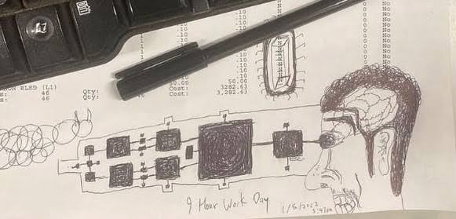

# the future is so far but close approaching

im writing this post mid day because it is a thought that i have been coming through with for the past bit

the future is something that is hard to think about for me. unless i have a prospect absolutely set in stone, the future is unattainable and gross.

my thoughts are kind of everywhere for this post, as i dont have a concrete thought, but i believe sylvia plath puts my thoughts into perfect writing.

*"I saw the years of my life spaced along a road in the form of telephone poles, threaded together by wires. I counted one, two, three . . . nineteen telephone poles, and then the wires dangled into space, and try as I would, I couldn't see a single pole beyond the nineteenth."*

this is how i see my life. only i cannot see to a nineteenth pole, what has happened is strung up already, the poles in my life erected of past experiences and the wires that connect them spindling and intertwining with eachother to connect to the poles. the poles are birthdays specifically, with the 8th approaching in less than two days, the pole is visible to me in a dark fog, but right past the pole is more of this pure darkness. 

i have vague prospects of the future, some of which are hazier now than before, facts changing, circumstances shifting, the logistics.

im getting a job. i hate being away from things, i hate work. i just want money.

the closest event is on november 20th. driving test. i am confident in my ability, but the anxiety of something final, a decision, one that if i fail i lose out on many more opportunities and a loss of the fee you pay to take the test.

after this is applications to universities. i dont know a date on this. i have no portfolio. i dread going to TMU or York or SCAD, some less dreaded than others due to prospects of people, but its all terrifying. for the former two i will know no one, just a bit away from home. for SCAD i have someone for me nearby, something that is a far light in this darkness beyond the poles, but the thought of being so far, of the money i would need to spend, its scary.

after this is march. march break. this is my light. my brightest star for the future. the thought of being close and touch and love. i want this to come sooner. i need it to come sooner. i want to come home to you.

after this is graduation. graduation is so far. i have no reason to think about it.

after is university. i dont know what im doing.

that is something i find a lot.

i dont know what im doing.

i want to write

i want to love

i am not good at either

i can get better

i cannot see my life being better

i have options

heres this post's song, 7 Days Til Sunday by TV Girl.

<iframe data-testid="embed-iframe" style="border-radius:12px" src="https://open.spotify.com/embed/track/1EKDVrhKvTdI8tIJ1oGyii?utm_source=generator&si=e0c57c9cfce44ca1" width="100%" height="152" frameBorder="0" allowfullscreen="" allow="autoplay; clipboard-write; encrypted-media; fullscreen; picture-in-picture" loading="lazy"></iframe>

